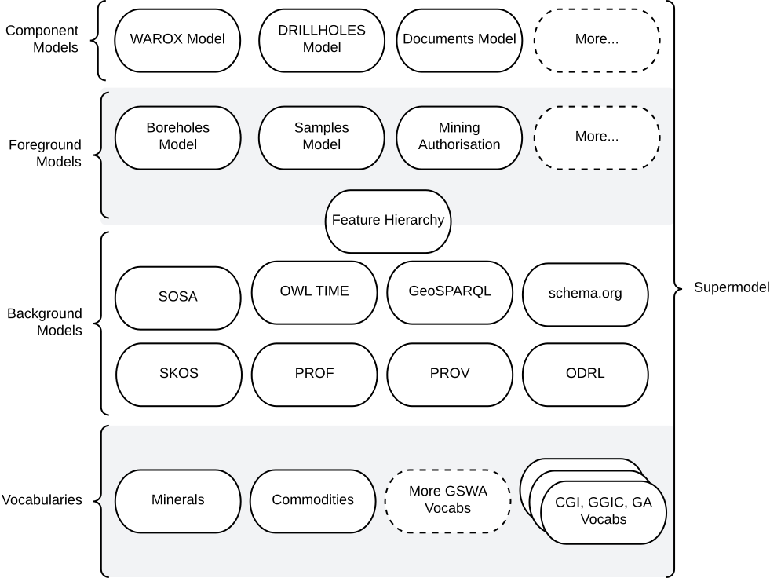
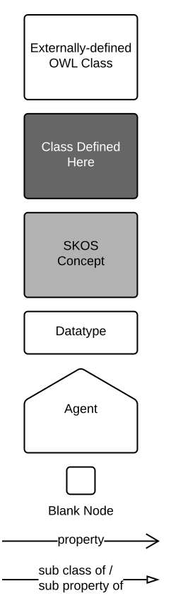

# The Supermodel

## Overview

This is a documentation website for the [Geological Survey of Western Australia](https://dmp.wa.gov.au/Geological-Survey/Geological-Survey-262.aspx)'s enterprise data mode.

This enterprise data model is known as a 'Supermodel' and it contains multiple dataset/system models. It is built following a formulaic creation of a multipart model.

| Question                               | Answer                                                                                                                     |
|----------------------------------------|----------------------------------------------------------------------------------------------------------------------------|
| What is a Supermodel, in detail?       | See the next few sections<br />See the [Supermodel definition](https://linked.data.gov.au/def/supermodel)    |
| What is the status of this Supermodel? | See [Status](#status) below                                                                                                |
| What other Supermodels?                | See the [Related Supermodels](#related-supermodels) section of [this Supermodel's description](index.md) |


<figure markdown>
    
  <figcaption>An informal overview of this Supermodel and its various parts.</figcaption>
</figure>

## Introduction

This "Supermodel" is a multipart model used to coordinate expressions of data from multiple systems within the Geological Survey of WA (GSWA). Specifically, this model allows for:

* integration of data across systems
* multi-system data holding analytics
* system rationalisation planning
* delivery of coordinated/interoperable data

The major parts of this Supermodel are shown in [Figure S1](#the-supermodel) above.

Only a few of the total Vocabularies and Component Models of this Supermodel have so far been defined: see the status in [Overview/Status](index.md#status).

### Related Supermodels

This Supermodel relates to several other Supermodels. The table below gives some details.

| Supermodel                                                                                       | Relationship                                                                                                                                                                                                                                                                                                                                                                                                          |
|--------------------------------------------------------------------------------------------------|-----------------------------------------------------------------------------------------------------------------------------------------------------------------------------------------------------------------------------------------------------------------------------------------------------------------------------------------------------------------------------------------------------------------------|
| [International Stratigraphic Commission's Supermodel](https://stratigraphy.org/data-models) | An enterprise data model for the international stratigraphy domain, managed by the authoraititive scientific body. Parts of this Supermodel, e.g. the [Stratigraphic Chart dataset](https://stratigraphy.org/chart), are reused directly by the GSWA Supermodel
| [Geological Survey of Queensland's Supermodel](https://geological-survey-of-queensland.github.io/gsq-supermodel/) | Created for the same purpose as the GSWA Supermodel, for Queensland's Geologicla Survey
| [Foundational Spatial Data Framework Supermodel](https://linked.data.gov.au/def/fsdf-supermodel) | The FSDF Supermodel was created by [Geoscience Australia](https://www.ga.gov.au) to integrate multiple foundational spatial datasets within Australia. It specifies both a structure for spatial data and particular fundamental objects to join datasets with, such as authoritative boundaries for Australia and the states.<br /><br />This supermodel adopts the FSDF Supermodel ways of working for spatial data |
| [Queensland's Spatial Data Supermodel](https://linked.data.gov.au/def/qsi-supermodel)                                               | A For joining multiple fundamental state spatial datasets. It implements many of the same Background Models, Vocabularies and some of the same Component Models, such as [Boreholes](foreground/bore.md)                                                                                                                                                                                                              |
| [Environmental Information Australia Supermodel](https://linked.data.gov.au/def/qsi-supermodel)                                                   | An emerging Supermodel that includes a series of national environmental datasets across several Federal government agencies. It shares many background models that cover sampling, sites, spatiality, projects etc.                                                                                                                                                                                                   |

### Supermodel Structure

The structure of this Supermodel follows the [Supermodel Model](https://linked.data.gov.au/def/supermodel) and consists of:

* [Backbone Model](backbone.md)
    * the high-level model that joins all the Component Models together
* [Component Models](components)
    * the detailed models for major datasets held by GSWA
* [Background Models](background.md)
    * models that the Backbone and Component models extend to implement generic patterns and keep aligned
* [Vocabularies](vocabularies.md)
    * controlled lists of terms used by all of the above models
    * the various models all indicate which vocabularies they rely on
    * see [GSWA's vocabularies online](https://vocabulary.gswa.kurrawong.ai/v/vocab)

Additionally, this Supermodel contains the following model support content:

* [PID Policy](pids)
    * a policy for the creation of Persistent Identifiers (PIDs) for all the models within this Supermodel and any data created to conform to these models

### Technical Assets

All parts of this Supermodel, for example individual Component Models or supporting vocabularies, are outlined here in
human-readable form (documentation) and their machine-readable forms, such as their schemas and data validators, are
linked to as well.

Within the formal definition of this Supermodel, all the 'resources' of the Supermodel parts are listed and the roles
that each play are given. See the [Supermodel Definition](#supermodel-definition).

### Supermodel Definition

The machine-readable definition of this Supermodel is a Turtle file, online at:

* [profile.ttl](rdf/profile.ttl)

Its content is rendered in human-readable form as follows:

| Resource                                                                    | Role                                                                         | Description                                                                                             |
|-----------------------------------------------------------------------------|------------------------------------------------------------------------------|---------------------------------------------------------------------------------------------------------|
| [Supermodel Definition](rdf/profile.ttl) | [Profile](https://www.w3.org/TR/dx-prof/#Class:Profile)                      | The formal definition of this Supermodel, including all its parts                                       |
| **Component Models**                                                        |                                                                              |
| [Bore Model](foreground/bore.md)                                            | [Component Model](https://linked.data.gov.au/def/supermodel/component-model) | A model that describes physical, functional and operational aspects of Bores, sometimes known as Wells. |                                                                   
| **Background Models**                                                       |                                                                              |
| **Vocabularies**                                                            |                                                                              |

## Modelling Documentation

The following subsections apply to all models linked to and within this Supermodel.

### Definitions

| Term             | Meaning                                                                                                                                                                                                                                                                     |
|------------------|-----------------------------------------------------------------------------------------------------------------------------------------------------------------------------------------------------------------------------------------------------------------------------|
| **Foreground Model** | Any model that you can expect to create data according to. Component Models are Foreground Models but there are other Foreground Models which to not correspond directly to a spcific system, such as the [Bore Model](foreground/bore.md) which is used by multiple system |
| **Background Model** | A generic model that Foreground and Component models extend. Bakcground Modles msy be used directly or indirectly, through these extending models                                                                                                                           |
| **Component Model**  | A Foreground Model that corresponds to a data system. For example WAROX, GSWA's  field observation sites and information database has a model of its content, the [WAROX Foreground Model](components/warox.md).                                                            |
| **Profile** | A Profile is a model that substantially inherites from one or more other models. It may not even declare any new elements but only contrain the use of existing model celements

### Diagram Conventions

All the models within this Supermodel are visualised with informal OWL diagrams. These are diagrams that represent the Classes, Properties and Axioms of the [Web Ontology Language](background.md#web-ontology-language-owl) with the elements shown in Figure K below.

<figure markdown>
  { width="75%" }
  <figcaption>Figure K: OWL Diagram Element Key</figcaption>
</figure>

### Namespaces

Namespaces provide unique identity to elements within this Model - classes, predicates, validation shapes and example data. Prefixes for namespaces are used to assist with documentation readability.

Where you see a prefix used, something like `xxx:`, it is to be replaced with the namespace for complete term definition. For example, using the table below, we can understand that `bore:Bore` is equivalent to `https://linked.data.gov.au/def/borehole/Bore`.

The following prefixed namespaces are used in class and property definition tables and the code examples following:

| **Prefix** | **Namespace**                           | **Description**                                                                                                                |
|------------|-----------------------------------------|--------------------------------------------------------------------------------------------------------------------------------|
| `ex`       | `http://example.com/`                   | Non-resolvable namespace for examples                                                                                          |
| `bore`     | `https://linked.data.gov.au/def/bore/`  | The namespace for the [Bore Model](foreground/bore.md)                                                                         |
| `dcat`     | `http://www.w3.org/ns/dcat#`            | [Data Catalogue vocabulary](https://www.w3.org/TR/vocab-dcat/): cataloguing international standard                             |
| `dcterms`  | `http://purl.org/dc/terms/`             | [Dublin Core Terms](https://www.dublincore.org/specifications/dublin-core/dcmi-terms/): basic library catalogue-style metadata |
| `geo`      | `http://www.opengis.net/ont/geosparql#` | [GeoSPARQL](https://docs.ogc.org/is/22-047r1/22-047r1.html): Semantic Web spatial data international standard                  |
| `prov`     | `http://www.w3.org/ns/prov#`            | [Provenance Ontology](https://www.w3.org/TR/prov-o/): provenance data structures international standard                        |
| `rdfs`     | `http://www.w3.org/2000/01/rdf-schema#` | [RDF Schema vocabulary](https://www.w3.org/TR/rdf12-schema/): Basic structural RDF elements                                    |
| `schema`   | `https://schema.org/`                   | The general-purpose [schema.org](https://schema.org) model                                                                     | 
| `skos`     | `http://www.w3.org/2004/02/skos/core#`  | [Simple Knowledge Organization System](https://www.w3.org/TR/skos-reference/): a model for controlled vocabularies             |
| `xsd`      | `http://www.w3.org/2001/XMLSchema#`     | [XML Schema Definitions Datatypes](https://www.w3.org/TR/xmlschema11-2/)                                                       |

These namespaces appear at the start of RDF data files in the [Turtle](https://www.w3.org/TR/turtle/) format (see next
subsection) and SPARQL query text (the section after the next section) in a form similar to this table, for example in
the schema for the [Bore Model](foreground/bore.md) you can see the prefix `bore` for its namespace on the first line:

* `PREFIX bore: <https://linked.data.gov.au/def/bore/>`

### RDF code

Many examples for the models within this Supermodel and all machine-readable assets are stored in the [Turtle](https://www.w3.org/TR/turtle/) format. This format is a compact representation of RDF data and is generally considered to be the most human-readable form that raw RDF data can take.

An example:

```turtle
ex:b-01
    a bore:Bore ;
    schema:depth [
        a schema:QuantitativeValue
        schema:value 239 ;
        schema:unitCode unit:M ;
    ] ;
.
```

In the example above (from the [Bore Model](foreground/bore.md)'s `Quantitative Value` class), we have a dummy ID for an instance of a `Bore` - `ex:b-01` - with its class indicated - `ex:b-01 a bore:Bore` - and its depth given as a nested object, indicated by the _predicate_ `schema:depth`:

```turtle
[
    a schema:QuantitativeValue
    schema:value 239 ;
    schema:unitCode unit:M ;
]
```

The nested depth object above is a _Blank Node_, that is an object whose ID we don't need to know because it's a child object of something else.

All the prefixes in this code such as `ex:` and `schema:` are defined in the [Namespaces](#namespaces) section above and are expanded when this code is read by machine to full values, e.g.

`ex:b-01` &rarr; `<http://example.com/ex:b-01>`

### SPARQL queries

The [SPARQL query language](https://www.w3.org/TR/sparql12-query/) is the standard way to query Knowledge Graph RDF data.
SPARQL queries, which look a lot like SQL queries, specify a pattern that is used to extract part from a larger Knowledge
Graph, a "subgraph".

For example, if we have the following data:

```turtle
ex:b-01
    a bore:Bore ;
    schema:location ex:Kimberleys ;
    schema:depth [
        a schema:QuantitativeValue
        schema:value 239 ;
        schema:unitCode unit:M ;
    ] ;
.

ex:b-02
    a bore:Bore ;
    schema:location ex:Plibara ;
    schema:depth [
        a schema:QuantitativeValue
        schema:value 1073 ;
        schema:unitCode unit:M ;
    ] ;
.

ex:b-03
    a bore:Bore ;
    schema:location ex:Plibara ;
    schema:depth [
        a schema:QuantitativeValue
        schema:value 38 ;
        schema:unitCode unit:M ;
    ] ;
.
```

Then the following query may be applied:

```sparql
SELECT ?bh
WHERE {
    ?bh 
        a bore:Bore ;
        schema:location ex:Plibara ;
        schema:depth/schema:value ?depthValue ;
    .
    
    FILTER (?depthValue > 100)
}
```

The above query will extract objects of class Bore - `?bh a bore:Bore` - with location of `ex:Plibara` and depth greater than 100. The result will be the ID of `ex:b-02`.

### Persistent Identifiers

See the dedicated page: [Persistent Identifiers](/pids).

## Status

**November 2026**

As of November 2026, data from multiple GSWA datasets/systems is converted into the RDF data format and aligned with the models within this supermodel. The converted data is then aggregated into the GSWA Knowledge Graph which feeds the GSWA Discovery Portal, due for an public release in early December 2026. 

Data from GSWA's long-standing but siloed datasets of WAROX, MINEDEX, DRILLHOLES etc. are aligned with this Supermodel's Component Models, using major classes, such as `sosa:Sample`, `bore:Bore` etc. GSWA has also published many vocabularies in their [vocabulary server](https://vocabulary.gswa.kurrawong.ai/), all of which are constituted according to this Supermodel's background models fro vocabularies.

## Licence & Rights

This repository's content is available for reuse according to the [Creative Commons Attribution 4.0 International (CC BY 4.0)](https://creativecommons.org/licenses/by/4.0/).

This content is copyright as follows:

<div style="text-align:center;"><em>&copy; Government of Western Australia (Department of Mines, Industry Regulation and Safety), 2026</em></div>

## Contacts

This Supermodel is being authored for the [Geological Survey of Western Australia](https://dmp.wa.gov.au/Geological-Survey/Geological-Survey-262.aspx) within the [Department of Mines, Industry Regulation and Safety](https://www.dmirs.wa.gov.au).

For technical matters, please contact:

**Nicholas Car**  
_Coonsultant Data Architect_  
Geological Survey of WA  
Department of Mines, Industry Regulation and Safety  
<nick.car@dmirs.wa.gov.au>  
<https://orcid.org/0000-0002-8742-7730>  

For other matters, please contact:

**Geological Survey of Western Australia**  
<https://dmp.wa.gov.au/Geological-Survey/Geological-Survey-262.aspx>
